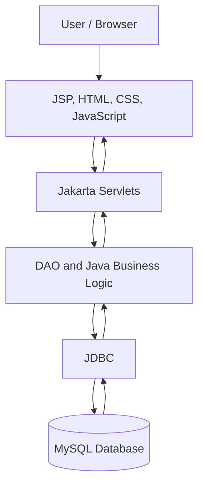

# 🍽️ Foodies — Food Delivery Web Application

Foodies is a Java-based food delivery web application that allows users to explore restaurants, browse menus, add food items to a cart, place orders, and view their order history.

## 🚀 Features

- Browse restaurant listings and restaurant details
- View restaurant menus with food images, descriptions, prices, and ratings
- Add food items to the cart and manage quantities
- Calculate order totals and delivery charges
- User login and session-based cart management
- Checkout and order placement
- View previously placed orders
- Store restaurant, menu, user, and order data in MySQL
- Responsive user interface with a green, gold, and cream theme

## 🛠️ Technologies Used

**Frontend**
- HTML
- CSS
- JavaScript
- JSP

**Backend**
- Java
- Jakarta Servlets
- JDBC
- DAO pattern

**Database**
- MySQL

**Server and Tools**
- Apache Tomcat 10.1
- Eclipse IDE
- MySQL Workbench
- Git and GitHub

## 🏗️ Application Flow

1. The user opens the restaurant listing page.
2. The application retrieves restaurant information from MySQL.
3. The user selects a restaurant and browses its menu.
4. The user adds food items to the cart.
5. The user proceeds to checkout and places an order.
6. The backend saves the order and order items in MySQL.
7. The user views order history through the My Orders page.

## 🗄️ Database

The application uses a MySQL database named `foodies`.

Main tables include:
- `Resturant` — restaurant details
- `menu` — food items and prices
- `User` — user information
- `orders` — order details and totals
- `Orderitem` — individual items belonging to orders

## ⚙️ How to Run

1. Install Java, Eclipse IDE, Apache Tomcat 10.1, and MySQL.
2. Clone or import this repository into Eclipse.
3. Configure the MySQL database and connection settings.
4. Ensure the MySQL Connector/J library is available to the project.
5. Configure the project to run on Tomcat 10.1.
6. Start the server and open:

   `http://localhost:8080/Test1Project/resturant`

## 🎯 Project Objective

This project demonstrates Java web development, JSP and Servlet integration, JDBC database connectivity, session management, shopping cart functionality, and order processing.

## 👨‍💻 Developer

**Rajeev Jeeva**

GitHub: [Venkat3247](https://github.com/Venkat3247)

---

*Built as a Java web development project for learning and demonstrating full-stack application development.*

## 📊 System Architecture

